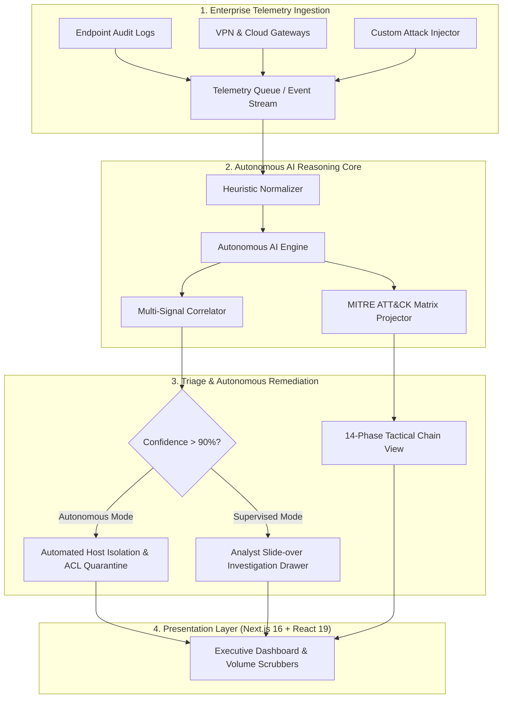

<div align="center">

# 🛡️ SentinelSOC

### Autonomous Threat Intelligence & Incident Response Platform
**Graduation Project — Version 0.1 (Alpha)**

[](https://nextjs.org/)
[](https://react.dev/)
[](https://www.typescriptlang.org/)
[](https://tailwindcss.com/)
[](./package.json)
[]()

<br />

<p align="center">
  <b>SentinelSOC</b> is an enterprise-grade, autonomous Security Operations Center (SOC) platform engineered to overcome L1/L2 alert fatigue, accelerate Mean Time to Respond (MTTR), and project threat progression along the MITRE ATT&CK enterprise matrix in real time.
</p>

[Explore Dashboard](http://localhost:3000/dashboard) • [Alerts Investigation](http://localhost:3000/alerts) • [MITRE Matrix](http://localhost:3000/mitre) • [Autonomous AI Hub](http://localhost:3000/realtime)

</div>

---

## 📋 Executive Summary

As enterprise attack surfaces expand across hybrid infrastructure, modern SOC analysts face hundreds of noisy telemetry streams each hour. Traditional SIEMs record alerts; **SentinelSOC actively reasons over them**.

Built as an advanced **Graduation Project (v0.1)**, SentinelSOC demonstrates how autonomous AI pipelines can intake raw multihost telemetry, evaluate process trees and egress anomalies, predict adversary kill chains, and deploy active quarantine measures in sub-second intervals.

---

## ⚡ Architectural Blueprint



---

## ✨ Core Platform Modules

### 1. 📊 Executive Security Dashboard (`/dashboard`)
* **Key Performance Indicators (KPIs)**: Total alerts, Mean Time to Detect (MTTD), open critical incidents, and active collector health.
* **Interactive 24-Hour Alert Volume Scrubber**: Custom SVG scrubbing line chart featuring continuous zero-gap column hitboxes, glowing vertical crosshairs, and expanding animated ripple halo rings on hover with floating glassmorphic tooltips.
* **Severity Distribution & Mix**: Visual breakdown of incident severities with dynamic donut segments and hover inspect states.
* **Rules & Tactics Auditing**: Breakdown of triggered correlation rules and high-impact attack tactics across monitored endpoints.
* **Latest Alerts Table & Investigation Drawer**: Quick-triage table with slide-over drawer providing instant host telemetry inspection, status updates, and resolution workflows.

### 2. 🔍 Alerts & Incident Investigation Hub (`/alerts`)
* Full-scale enterprise alert management table with pagination, debounced multi-field search, and severity/status filter toggles.
* Detailed metadata inspecting adversary techniques, target hosts, detection timestamps, and MITRE classification.
* Interactive slide-over investigation panel with full analyst remediation actions.

### 3. 🎯 MITRE ATT&CK Tactical Matrix (`/mitre`)
* Real-time projection across 14 enterprise kill-chain phases (from Initial Access and Execution to Lateral Movement, Exfiltration, and Impact).
* Visual tactic heatmaps, active technique counters, and dedicated drill-down drawers for investigating tactics.

### 4. 🧠 Autonomous AI Real-Time Intelligence (`/realtime`)
* **Autonomous Ingestion Stream**: Real-time simulated threat arrivals with automated AI analysis cycle.
* **Live AI Reasoning Engine**: Streaming thought logs, verdict generation, calculated confidence scores, and automated remediation triggers.
* **Interactive Scenario Injector**: Inject simulated or custom cyber incidents (Brute Force, Cobalt Strike Beaconing, Ransomware Pre-Encryption, Credential Dumping) with one-click presets.
* **Autonomous Mode Toggle**: Switch between fully autonomous containment and supervised analyst review.
* **Instant Incident Reporting**: Auto-generated forensic debriefing cards with Markdown-formatted verdicts and tactical timelines.

### 5. 🔐 Enterprise Authentication Gateway (`/login` & `/register`)
* **2/3 Showcase + 1/3 Contained Form**: Responsive layout allocating two-thirds of the viewport to high-impact branding and an automated security insights text rotator, while keeping the login/sign-up forms contained within a dedicated column.
* **Strict Viewport Containment**: Locked to `h-screen overflow-hidden` with an independent internal scroller on the form panel to prevent whole-page layout shifts.
* **Concentric Tactical Radar**: Animated radar sweep with dynamic threat blips.
* **Theme Synchronized**: Instant Light / Dark mode switching across all authentication views.

---

## 🎨 Design System & Color Tokens

SentinelSOC implements a curated, dark-mode-first aesthetic powered by Tailwind CSS v4 `@theme` design tokens:

| Token Name | Hex Code | Purpose |
|---|---|---|
| `--color-brand-ink` | `#22223b` | Deep midnight structural backgrounds & dark cards |
| `--color-brand-plum` | `#4a4e69` | Secondary structural elements & subtle panels |
| `--color-brand-mauve` | `#9a8c98` | Muted typography, borders, and tactical grid lines |
| `--color-brand-rose` | `#c9ada7` | Primary luminous accent, glows, and key highlights |
| `--color-brand-paper` | `#f2e9e4` | High-contrast foreground text and light background |
| `--color-status-error-500` | `#b83d4d` | Critical alerts, active threat blips, and high urgency |
| `--color-status-warning-500` | `#e7b33c` | Medium/High warnings and suspicious beacons |
| `--color-status-success-500` | `#5cad86` | Normal status, active collectors, and resolutions |
| `--color-status-info-500` | `#8fb0e6` | Informational telemetry and baseline metrics |

---

## 🌐 SEO & Vector Branding

* **Automated Favicon & App Icon**: Handcrafted vector SVG icon (`public/favicon.svg` & `src/app/icon.svg`) featuring a tactical shield contour, concentric radar sweeps, and active red threat blips.
* **Dynamic OpenGraph & Twitter Cards**: Embedded social metadata with high-fidelity summaries for rich sharing.
* **Title Template & Route Hierarchy**: Clean `%s | SentinelSOC` title propagation with descriptive summaries across every view.

---

## 💻 Tech Stack & Dependencies

* **Core Framework**: [Next.js 16.4.2](https://nextjs.org/) (App Router, Turbopack)
* **Runtime / UI**: [React 19.3.0](https://react.dev/)
* **Type System**: [TypeScript 5.x](https://www.typescriptlang.org/) (Strict mode, zero `any`)
* **Styling Engine**: [Tailwind CSS v4](https://tailwindcss.com/)
* **Motion & Animation**: [Motion](https://motion.dev/) (`motion/react`)
* **Client State & Caching**: [TanStack Query v5](https://tanstack.com/query/latest)
* **Iconography**: [Lucide React](https://lucide.dev/)

---

## 🚀 Getting Started

### Prerequisites
* **Node.js**: v18.18.0 or later (Node 20+ recommended)
* **Package Manager**: `npm`, `yarn`, or `pnpm`

### Installation

1. **Clone the repository**:
   ```bash
   git clone https://github.com/your-username/SentinelSOC.git
   cd SentinelSOC
   ```

2. **Install dependencies**:
   ```bash
   npm install
   ```

3. **Start the local development server**:
   ```bash
   npm run dev
   ```

4. **Open the platform**:
   Visit [http://localhost:3000](http://localhost:3000) in your browser.

### Scripts

* `npm run dev` — Launch Next.js Turbopack development server on port 3000
* `npm run build` — Create optimized production build with static route prerendering
* `npm run start` — Serve the production build
* `npm run lint` — Run ESLint across all source files
* `npx tsc --noEmit` — Run TypeScript compiler check without emitting output

---

## 🗺️ Project Roadmap

- [x] **v0.1.0 (Current - Graduation Project Alpha)**
  - [x] Executive dashboard with interactive 24-hour volume scrubbers
  - [x] Alerts investigation table with slide-over drawer
  - [x] MITRE ATT&CK 14-tactic matrix with forensic detail panel
  - [x] Autonomous AI real-time incident triager and custom scenario injector
  - [x] Contained 1/3 split-screen authentication with internal scrolling
  - [x] Tailwind CSS v4 tokenized design system and vector SVG branding
- [ ] **v0.2.0 (Planned)**
  - [ ] WebSocket streaming backend integration
  - [ ] Real-world SIEM syslog & CEF log parser
  - [ ] Automated PDF incident report export
  - [ ] Multi-tenant organization switching

---

## 📜 Academic Integrity & License

This project was developed as a university **Graduation Project (v0.1)** in Computer Science / Cybersecurity. Released under the [MIT License](./LICENSE).

---

<div align="center">
  <sub>Developed with ❤️ for advanced enterprise cybersecurity operations.</sub>
</div>
